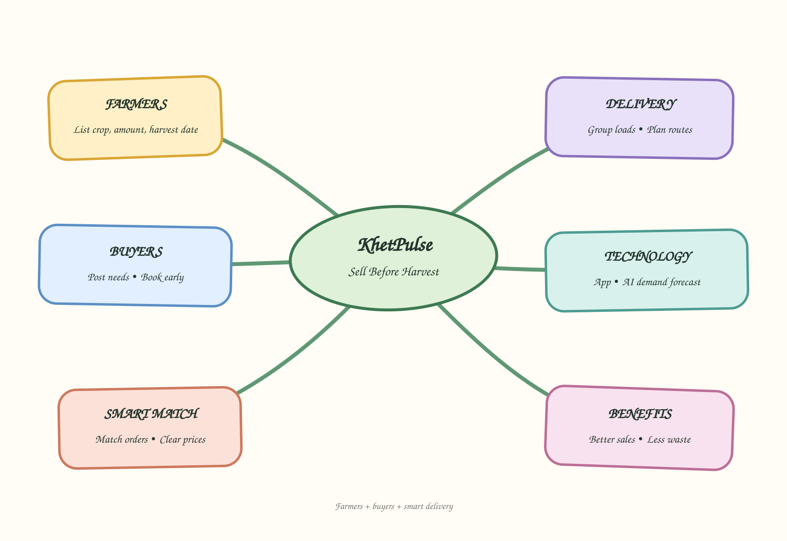

# Smart India Hackathon Workshop
# Date:23/11/2026
## Reference Number:26010234
## Name:Suryaprakash PN

## Problem Title
SIH 26033: Multiple intermediaries reduce farmers earnings and increase consumer prices.

## Problem Creater's Organization
Ministry of Consumer Affairs, Food & Public Distribution

## Theme
Agriculture, FoodTech & Rural Development

## Problem Description
Expected Solution: Create a digital marketplace that:

• Connects farmers/FPOs directly with consumers and bulk buyers.
• Provides logistics support.
• Uses AI for demand forecasting and route optimization.

Benefits:

• Better prices for farmers.
• Lower prices for consumers.
• Reduced supply chain inefficiencies.

## Proposed Solution
KhetPulse: A “Harvest Before Harvest” Marketplace
KhetPulse helps farmers sell their crops before they are picked. Instead of waiting until harvest and then accepting whatever price is available, farmers and FPOs post an expected harvest—crop, estimated quantity, location, quality, and likely harvest date. Buyers place advance orders, and the platform groups nearby orders into efficient collection and delivery runs.

The distinctive idea is a shared harvest plan: KhetPulse combines small quantities from nearby farms into one reliable supply for a buyer, while keeping each farmer’s price and payment visible. Buyers can reserve part of a future harvest, and farmers can see likely demand before deciding how much to plant or bring to market.

The goal is to make the supply chain more predictable and transparent—not to promise a particular price or eliminate every intermediary.

## Technical Approach
Farmer-friendly listing: Farmers or FPOs add crop details using a simple mobile app, WhatsApp, or assisted village service. The system supports local languages and low-bandwidth use.

Harvest passport: Each lot gets a digital record with its source, expected harvest date, quantity, grade, and handling information. A photo and a basic field quality check can help buyers understand what they are reserving.

Advance demand matching: Buyers such as retailers, hotels, processors, and housing societies post what they need and when. The platform matches those orders with upcoming harvests and suggests a price range based on local market information and the lot’s details.

Flexible commitments: Buyers can reserve a portion of a future lot. Farmers can choose how much to commit, and the platform can show the order terms, expected deductions, and payment timeline before confirmation.

Shared collection and delivery: KhetPulse groups nearby farm lots and buyer orders into collection routes. It can match available vehicles and, where practical, suggest shared collection points or temporary storage. Route suggestions should account for distance, delivery time, vehicle capacity, and whether the crop needs cooling.

Demand and route forecasting: Early versions can use past orders, seasonality, local prices, weather forecasts, and buyer schedules to estimate demand and plan routes. Predictions should be shown as guidance, with human review and the ability to correct inaccurate estimates.

Transparent settlement: The farmer sees the sale price, platform or logistics charges, and expected net payment before accepting. Payments and delivery records are tracked through the platform.

## Feasibility and Viability
hetPulse can begin as a pilot in one crop cluster and one nearby town. A practical first version would focus on farmer/FPO listings, buyer orders, basic matching, route grouping, and payment records. Forecasting can start with simple historical trends and improve as reliable local data accumulates.

The model can build on existing FPOs, farmer groups, local transporters, collection centers, and market information systems. India’s e-NAM already supports online trading and broader buyer access, while government material has identified logistics as an important part of enabling inter-mandi trade. KhetPulse could complement such systems by coordinating advance demand, aggregation, and last-mile movement. e-NAM, Government of India information on e-NAM logistics

Possible revenue sources include a clearly disclosed transaction fee, buyer subscriptions for recurring procurement, and optional logistics coordination fees. The pilot should measure farmer net earnings, buyer prices, delivery reliability, spoilage, and repeat use before expanding.

Key practical challenges include inaccurate harvest estimates, quality disputes, late cancellations, seasonal supply changes, and uneven internet access. The pilot can address these through assisted onboarding, flexible order quantities, clear cancellation rules, transparent grading, and a human support channel.

## Impact and Benefits
More choice for farmers: Farmers can compare buyer offers and see  estimatednetearnings before accepting.
Earlier visibility of demand: Advance orders help farmers and FPOs plan harvest, aggregation, and sales.
Better access for small producers: Pooling produce lets small farms participate in orders that would otherwise require larger volumes.
More predictable buying for consumers and institutions: Buyers can plan procurement and potentially reduce unnecessary purchasing through better demand estimates.
Fewer avoidable transport steps: Grouping nearby lots and orders can reduce empty trips and improve vehicle use.
Reduced spoilage risk: Better coordination of harvest and delivery may help produce spend less time waiting for a buyer or vehicle.
More accountable transactions: Digital records make price, quantity, quality, deductions, and payment status easier to review.

## Research and References
National Agriculture Market (e-NAM), Government of India: Background on the national electronic trading platform and its market functions.
Parliament of India document on e-NAM: Notes that logistics can be a hurdle for inter-state and inter-mandi trade, and discusses logistics service integration. 
Small Farmers Agribusiness Consortium (SFAC): Information on FPOs and market linkages through digital platforms.
FAO, Digitalization pathways for food loss and waste prevention: Reviews digital tools in agri-food supply chains, including logistics, inventory, and demand-related application
